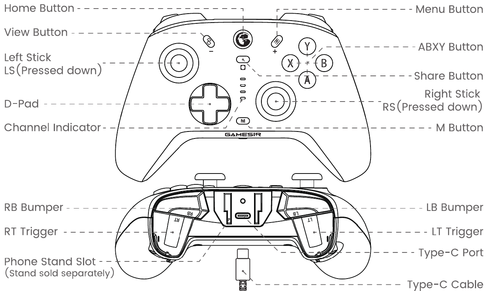
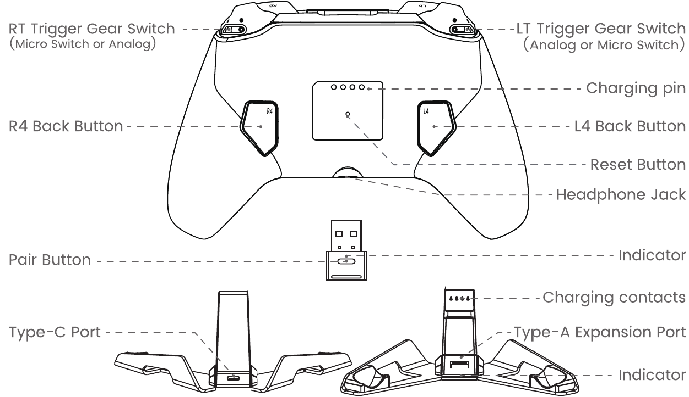
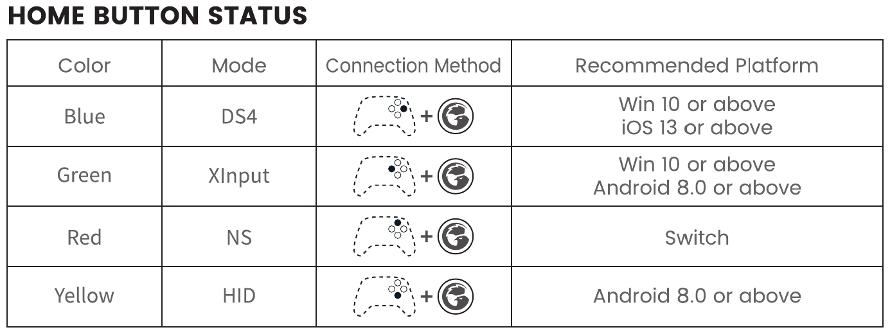

# GameSir Cyclone 2 — button combinations, without the software

Every on-controller shortcut for the **GameSir Cyclone 2**, with a source and a confidence rating on each entry.

GameSir's manual prints most combinations as icon glyphs that don't survive into any text version of the PDF, and the rest are scattered across product FAQs for other models, forum replies and reviews. This is the result of collecting all of it and cross-checking where the sources disagree.

- **Model:** GameSir Cyclone 2 (not Cyclone 2 Pro, not T4 Cyclone Pro — combinations differ)
- **Not compatible with:** Xbox, PS4/PS5 (native)
- **Verified on firmware:** controller `V3.4.6`, dongle `V1.2.0`


## Confidence legend

Most wrong information about this controller comes from someone stating an inference as fact. So every entry is tagged:

| Tag | Meaning |
|---|---|
| **A** | Stated in GameSir's own Cyclone 2 documentation |
| **B** | Documented for a closely-related GameSir model, or corroborated by a hands-on source. Verify once. |
| **C** | Weak or single-source. Test before relying on it. |

Where sources contradict each other, both readings are given rather than one being picked silently.

## Device layout

### Front / top

```
    ◜ LT ◝                                      ◜ RT ◝
    [ LB ]              ( USB-C )               [ RB ]

         \ V \            ( H )           / M /
                          [ S ]

      (( ● ))                                  (Y)
      L-Stick                              (X)     (B)
                                                (A)

          ▲
       ◄  ■  ►            [ m ]              (( ● ))
          ▼                                   R-Stick
        D-Pad
```

| Symbol | Button |
|---|---|
| `LT` / `RT` | Left / right trigger |
| `LB` / `RB` | Left / right bumper |
| `USB-C` | Charging / wired data port |
| `V` | View button |
| `M` | Menu button |
| `H` | Home button |
| `S` | Share button (a.k.a. Screenshot in GameSir docs) |
| `m` | M button / multi-function (GameSir logo) |




### Back

```
  ◜ RB ◝            ( USB-C )            ◜ LB ◝
  [ RT ]                                 [ LT ]
 ( TR )                                   ( TL )
                   ---------
                   |* * * *|
        ___        |  (o)  |        ___
       /   |       --------        |   \
      /    |                       |    /
      \    |                       |    \
       \__/                         \__/
        R4                            L4

                    [ aux ]
```
```
   RB               UBC                LB
   RT                                  LT
  TR                                    TL
                   ---------
                   |* * * *|
        ___        |  (o)  |        ___
       /   |       --------        |   \
      /    |                       |    /
      \    |                       |    \
       \__/                         \__/
        R4                            L4

              [ aux ]
```

| Symbol | Item |
|---|---|
| `RB` / `LB`, `RT` / `LT` | Bumpers and triggers, mirrored from the front |
| `TR` / `TL` | Trigger gear switch, at the base of each trigger |
| `UBC` | USB-C port |
| `* * * *` | Charging pins (4 contacts, for the dock) |
| `(o)` | Reset button, inside the pinhole |
| `R4` / `L4` | Back paddle buttons |
| `aux` | 3.5 mm audio jack |




**Naming:** Xbox convention throughout — `LB`/`RB`/`LT`/`RT`, not L1/R1/L2/R2.

**Not marked above:** the channel indicator (four segments that show the active profile) and the two RGB lighting strips in the grips. Both are referenced in later sections.

---

## 1. Power, reset, factory reset

| Function | Combination | Notes | Conf. |
|---|---|---|---|
| Power on | `H` short press | Wakes the last-connected device | A |
| Power off | Hold `H` 5 s | | A |
| Power off + restore auto-detect | Hold `H` 10 s | Undoes a manual mode lock | A |
| Instant-on from dock | Lift controller off dock | | A |
| **Factory reset** | Hold `H` + `M` until the logo blinks | Resets the profile and all controller settings | A |
| Force power-off | Pin into the rear pinhole `(o)` | Hardware power cut. Does **not** clear settings. | A |

The pinhole is a power cut; `H` + `M` wipes configuration. GameSir lists both as remedies for a controller that won't power on or off.

---

## 2. Connection modes

Each platform mode has its own `H` + face button combination, held 2 s.

| Combination | Mode | Indicator | For | Device name | Conf. |
|---|---|---|---|---|---|
| `H` + `B` | DS4 | blue | Windows Bluetooth, iOS | `Wireless Controller` | A ⚠ |
| `H` + `X` | XInput | green | 2.4 GHz dongle | — | A ⚠ |
| `H` + `Y` | NS | red | Nintendo Switch | — | A |
| `H` + `A` | HID | yellow | Android | `GameSir-Cyclone 2` | B |

⚠ **Source conflict on `B` vs `X`.** GameSir's current support page gives `H` + `B` → blue and `H` + `X` → green. An earlier manual transcription gives `H` + `X` → blue. Both agree on `Y` → red. Hold each and read the colour; may be a firmware-revision difference.




| Function | Combination | Notes | Conf. |
|---|---|---|---|
| Check current mode | Hold `m` | Indicator shows mode colour. Read-only. | A |
| Re-enter pairing (current mode) | Hold `H` + `S` 2 s | Indicator blinks fast. For the dongle, also press the receiver's pairing button. | A |
| Cycle XInput / NS / DS4 | Hold `V` + `M` 2 s | Dongle and wired only. Pins the mode and disables auto-detection until `H` 10 s. | A |
| Wired connection | Plug in USB-C | Indicator goes solid | A |

**If a mode won't pair with its `H` + button combo, cycle to it with `V` + `M` instead.** Connect by dongle or USB first, then hold `V` + `M` until the indicator reaches the colour you want. This reaches modes the direct pairing combos sometimes fail to enter, and is the more reliable route when a mode seems unavailable.

**Dongle limits.** The receiver is generally reported as XInput-only, with DInput modes needing Bluetooth — yet `V` + `M` is documented as cycling XInput/NS/DS4 *in receiver mode*. Unresolved; matters for section 10.

**GameSir Connect only sees the controller in XInput** over dongle or USB. Blind to DS4 and NS over Bluetooth.

---

## 3. Triggers

| Function | Combination | Notes | Conf. |
|---|---|---|---|
| Hair trigger toggle | Hold `m` + `LT` or `RT` 2 s | Per trigger. Home indicator flashes when that trigger is pressed while active. Persists across restarts. | A |

Two separate mechanisms: the physical gear switch `TL`/`TR` selects the sensor path (Hall Effect or micro switch), while `m` + `LT`/`RT` selects the firmware behaviour of the Hall Effect path (analog or hair trigger). With the gear on micro switch the trigger is already binary and the toggle does nothing. Set the gear to analog before using this combo or calibrating.

---

## 4. Sticks

| Function | Combination | Notes | Conf. |
|---|---|---|---|
| Zero deadzone toggle | Hold `m` + `LS` or `RS` (stick click) 2 s | Per stick. Persists across restarts. | A |

This is a true 0, so expect apparent drift — that's the setting, not a fault. GameSir's guidance for the same feature elsewhere is that 3–5 is better, but that needs the software.

**Stick + trigger calibration** (set trigger gear to analog first) — conf. **A**:

1. Hold `V` + `M` + `H` 2 s → Home light flashes white slowly.
2. Touch nothing. Press `A` once.
3. Rotate both sticks in full circles 2–3 times. Fully press both triggers three times.
4. Press `A` to exit.

An older manual revision uses a different entry combo and a single confirm press. If the above doesn't respond, your firmware likely expects that flow.

---

## 5. Vibration

| Function | Combination | Notes | Conf. |
|---|---|---|---|
| Vibration level | `m` + D-pad `▲` / `▼` | 5 levels. Persists across restarts. | A |

Level 1 off · 2 = 25 % · 3 = 50 % · 4 = 75 % (default) · 5 = 100 %. Level 1 is the software-free way to kill rumble.

---

## 6. Profiles

| Function | Combination | Notes | Conf. |
|---|---|---|---|
| Cycle profile | `m` + **right** stick `▲` / `▼` | Four slots: Default, 1, 2, 3. Channel indicator shows the active one. | A |

Switches which slot is active, not what's in it. All four ship identical, so on a stock controller the indicator changes and nothing else does. Slots only diverge once populated via GameSir Connect.

Also the likeliest source of "hidden LED combo" reports — it is an LED that changes when you hold `m` and move a stick.

---

## 7. Turbo

| Function | Combination | Notes | Conf. |
|---|---|---|---|
| Set / cycle turbo on a button | Hold `m`, press the target button | Each repeat: Slow → Medium → Fast → Off | A |
| Clear all turbo | Double-click `m` | | A |

Assignable to `A` `B` `X` `Y` `LB` `RB` `LT` `RT`. Slow 8 Hz · Medium 12 Hz · Fast 20 Hz. Home indicator flashes continuously while any turbo is active. Persists across restarts.

Most common accidental activation on this controller. If a button starts auto-repeating, double-click `m` first.

---

## 8. Back paddles (L4 / R4)

Unassigned out of the box. Conf. **A**.

**Assign:** hold `m` + `L4` (or `R4`) until Home flashes white slowly → press the button or sequence to record → press `L4`/`R4` to save.

**Clear:** hold `m` + `L4`/`R4` until white flash → press `L4`/`R4` immediately without recording.

- Assignable: `A` `B` `X` `Y` `LB` `RB` `LT` `RT` `LS` `RS` `V` `M`, D-pad, both sticks.
- Macro timing is recorded as you enter it — pace your presses the way you want them replayed.
- Auto-saves and exits after 10 s of inactivity, so hesitating mid-macro truncates it.

---

## 9. Layout swap, gyro, lighting

| Function | Combination | Notes | Conf. |
|---|---|---|---|
| Swap `A`/`B` and `X`/`Y` | Hold `m` + `A` 2 s | Toggles Xbox layout (default) ↔ Nintendo layout. Persists across restarts. From T4 Cyclone Pro docs; the Cyclone 2 manual shows this as an icon only. | **B** |
| Gyro calibration | Lay flat, hold `m` + `S` 2 s | Indicator alternates red/blue; done when it returns to mode colour. Switch titles only. | A |

In NS mode `A`/`B` and `X`/`Y` appear swapped against the Xbox legend because Nintendo's layout differs. Only treat a swap as the toggle if it persists within a single mode.

### Lighting — no on-controller combo documented for this model

GameSir documents `m` + right stick / left stick / D-pad for lighting on the **Tarantula Pro** and **Nova**. For the **Cyclone 2**, every GameSir source says lighting is software-only, and the manual's combination table has no lighting entry. Conf. **C**.

Free axes to test: `m` + left stick `▲▼` / `◄►`, `m` + right stick `◄►`, `m` + D-pad `◄►`. (`m` + D-pad `▲▼` and `m` + right stick `▲▼` are taken.) Watch the grip strips — if the centre channel segments change instead, that's profile switching.

---

## 10. Linux / Steam Input — known open bug

[ValveSoftware/steam-for-linux #13311](https://github.com/ValveSoftware/steam-for-linux/issues/13311) — opened 2026-06-12, open and unassigned.

In **XInput mode over the 2.4 GHz dongle**, Steam misidentifies the controller as a **"Generic Gamepad"**. Proton games either fail to detect it or show numbered inputs instead of Xbox glyphs. The kernel (`xpad`/`xone`) binds correctly — this is Steam-side.

- USB ID `3537:100b`, descriptor string `Xbox 360 Controller for Windows`
- Reported on CachyOS/Arch, Steam build 1781041600
- DS4 and NS modes unaffected. Windows unaffected.

Likely cause (my inference, not in the issue): `3537` is GameSir's vendor ID, not Microsoft's `045e`, so the pair probably isn't in Steam's controller allowlist despite the Xbox-flavoured descriptor.

**Workarounds, best first:**

1. **DS4 mode over Bluetooth** (`H` + `B`). Confirmed by the reporter. Cost: PlayStation glyphs, Bluetooth latency.
2. **Disable Steam Input per-game.** Confirmed. Games use the kernel `xpad` device directly. Cost: no Steam Input remapping or gyro.
3. **Pin DS4 onto the dongle** with `V` + `M`. Untested; depends on the dongle question in section 2. If it works, best of both. Check `lsusb` and Steam's controller tab after.
4. **Custom SDL mapping** for `3537:100b` via `SDL_GAMECONTROLLERCONFIG`. Unverified for this device.

Single reporter, one distro, no Valve response in three months.

---

## 11. Firmware

| Function | Procedure | Conf. |
|---|---|---|
| Controller update | USB, XInput, *Update firmware* in GameSir Connect | B |
| Force controller update | Hold `m` + `M` while plugging in USB, Connect already open | C |
| Dongle update | Connect through the dongle, *Update firmware* | B |
| Force dongle update | Hold the dongle's sync button while plugging it in (light stays off), Connect open | C |

Reported matching versions: controller **V3.3.3**, dongle **V1.1.8**. Mismatched pairs cause dongle disconnects.

Connect is Windows-only and needs XInput over dongle or USB. Everything the combos set is stored onboard, so it only needs to run once.

⚠️ `m` + `M` is the force-flash trigger at plug-in time; `H` + `M` is the factory reset. Easy to confuse.

### If a firmware update crashes or hangs

1. **Pin-reset** — the only thing that works when the controller ignores every button. Press `H` to restart.
2. **Boots normally** → re-run the update, wired, nothing else plugged in.
3. **Boots but misbehaves** (wrong mode colour, dead buttons, no dongle) → half-written flash. Force-flash: hold `m` + `M` while plugging in USB with Connect open.
4. **Won't boot after pin-reset** → leave it on USB power a few minutes first (a flat battery looks identical to a brick), then retry step 3.
5. **Dongle stuck instead** → hold its sync button while plugging in, Connect open.

The pin-reset can't repair corrupted flash by itself and won't clear settings. For settings, use `H` + `M`.

Flash wired rather than over the dongle, don't let the machine sleep mid-update, do controller and dongle separately.

---

## 12. Indicators

**Home indicator — connection state**

| Pattern | Meaning |
|---|---|
| Slow blink, 1×/s | Reconnecting to a known device |
| Fast blink, 4×/s | Pairing mode, discoverable |
| Solid | Connected |
| Slow white blink | Programming or calibration mode |
| Continuous flashing | A turbo assignment is active |
| Red ×2 every 10 s | Battery below 15 % |
| Rapid red/blue alternating | Gyro calibration in progress |

**Charging (powered off)**

| Colour | Charge |
|---|---|
| Red | 0–25 % |
| Orange | 25–50 % |
| Yellow | 50–75 % |
| Green | 75–90 % |
| Green flash 2 s then off | 90–100 % |

The dock mirrors this.

**Auto power-off:** connected with no input 10 min · pairing 1 min · reconnecting 3 min.

---

## 13. Quick recovery

| Symptom | Fix |
|---|---|
| A button auto-repeats | Double-click `m` (turbo) |
| Stick creeps at rest | Hold `m` + that stick's click 2 s (zero deadzone) |
| Trigger actuates too early | Hold `m` + that trigger 2 s (hair trigger) |
| `A`/`B` or `X`/`Y` swapped within one mode | Hold `m` + `A` 2 s |
| A mode won't pair with its `H` + button combo | Connect by dongle or USB, then cycle to it with `V` + `M` |
| Wrong platform mode after a manual lock | Hold `H` 10 s, then power back on |
| Won't connect | Hold `H` + `S` 2 s; for the dongle, also press its pairing button |
| Rear paddle firing unexpectedly | Hold `m` + that paddle to white flash, press the paddle again |
| Connect can't see the controller | Switch to XInput, use dongle or USB |
| Something is set and you can't find which combo | Factory reset: hold `H` + `M` until the logo blinks |
| Unresponsive to everything | Pin the rear pinhole |
| Firmware update hung | Pin-reset, then force-flash with `m` + `M` held while plugging in USB |
| Linux: Steam shows "Generic Gamepad" | Known Steam bug — DS4 mode or disable Steam Input (section 10) |

---

## Open items

1. `H` + `B` vs `H` + `X` for blue/DS4 (section 2) — sources conflict.
2. Can the dongle carry DS4? (sections 2, 10) — decides the best Linux workaround.
3. Layout swap `m` + `A` (section 9) — from sibling models, not Cyclone 2 docs.
4. Any on-controller lighting combo (section 9) — undocumented for this model.
5. SDL mapping override for `3537:100b` (section 10) — unverified.

---

---

## Corrections

Open an issue — see [CONTRIBUTING.md](CONTRIBUTING.md). Include your **firmware versions**; that's usually what explains a combination working for one person and not another, and it's the variable missing from almost every contradictory report about this controller online.

Especially wanted:

- Anyone who can read the pairing-mode glyphs in the printed manual
- Confirmation of whether the 2.4 GHz dongle can carry DS4 mode
- Any working on-controller lighting combination (none is documented for this model)

## Licence

Text, tables and ASCII diagrams: [CC BY 4.0](LICENSE).
Images: see [images/README.md](images/README.md) — manufacturer figures are **not** covered by this repo's licence.


## Sources

- [GameSir official Cyclone 2 support manual](https://gamesir.com/support/manuals/gamesir-cyclone2-white) — pairing combos, gyro calibration, factory reset, calibration sequence
- [Cyclone 2 manual, full text](https://manuals.plus/gamesir/cyclone-2-multiplatform-controller-manual)
- [Cyclone 2 manual PDF (Best Buy mirror)](https://files.bbystatic.com/fVZcNI2ODYeTz9vPSogkbw==/User%2BManual)
- [Cyclone 2 manual, alternate transcription](https://manuals.plus/asin/B0DBLMZJRJ) — conflicting `H` + `X` reading
- [GameSir help centre — Cyclone 2](https://doc.xiaoji.com/en/cyclone2/detail/1604.html)
- [T4 Cyclone Pro manual](https://manuals.plus/m/bc23fcc2f9b55f440ddda54bcfaf0304ffe926e5bd77efb2143562e8721efccd) — `M` + `A` layout swap
- [Notebookcheck — Tarantula Pro layout switching](https://www.notebookcheck.net/The-GameSir-Tarantula-Pro-controller-can-switch-between-two-action-button-layouts.898946.0.html)
- [GameSir FAQ — Tarantula Pro](https://shop.gamesir.com/pages/faq-questions-about-tarantula-pro) — `M` + stick lighting, 0-deadzone guidance
- [GameSir Nova manual](https://manuals.plus/ae/1005006831159035) — `M` + stick lighting
- [Niche Gamer review](https://nichegamer.com/reviews/gamesir-cyclone-2/) — dongle is XInput-only
- [ValveSoftware/steam-for-linux #13311](https://github.com/ValveSoftware/steam-for-linux/issues/13311)
